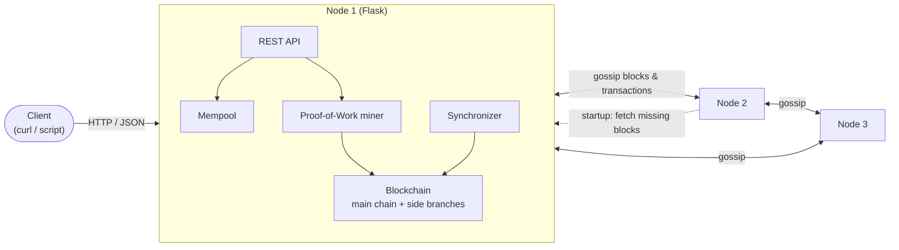
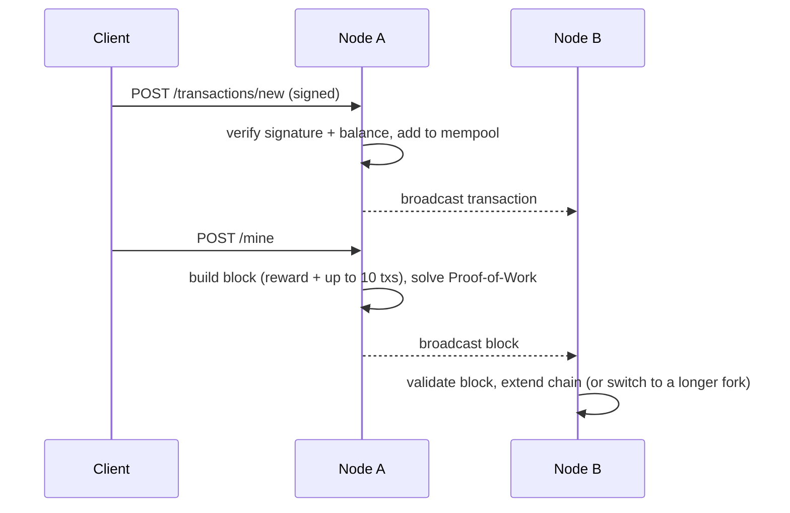

# Distributed Transaction Network

A small cryptocurrency network you can run on your own machine: several independent servers ("nodes") accept signed payments, bundle them into blocks, and agree on one shared history, even when nodes crash or disagree.

<!-- TODO: add demo -->


## New to blockchains? The 5 ideas you need

| Term | What it means here |
|---|---|
| **Transaction** | "Send 5 coins from A to B." The sender **signs** it with a private key, so nobody can forge or alter it. |
| **Mempool** | A waiting room for valid transactions that haven't been recorded yet. |
| **Block** | A bundle of transactions plus a fingerprint (hash) of the previous block, so blocks form a tamper-evident **chain**. |
| **Mining (Proof-of-Work)** | To add a block, a node must find a number that makes the block's hash start with several zeros. It's slow to find but instant to check, which makes rewriting history expensive. The miner earns a reward. |
| **Fork & longest chain** | If two nodes add different blocks at the same time, the network temporarily splits. Every node switches to the longest valid chain, so they converge again. |

## Tech Stack

Python · Flask (REST API) · `cryptography` (ECDSA signatures) · Docker Compose · pytest

## Features

- **Signed transactions**: ECDSA signatures and balance checks reject forged or overspending payments.
- **Proof-of-Work mining** with adjustable difficulty and a mining reward.
- **Peer-to-peer gossip**: new transactions and blocks are broadcast to every known node.
- **Fork resolution**: nodes keep side branches, switch to the longest chain, and return transactions from abandoned blocks to the mempool.
- **Crash recovery**: a restarted node downloads only the blocks it missed (incremental sync), with a full-chain fallback.
- **Observability**: `/status` and `/metrics` endpoints report chain length, reorganizations, sync calls, and more.

## Architecture



Every node is identical: a Flask server with its own mempool, miner, and copy of the chain. Nodes talk over plain HTTP; a new or restarted node registers with a known "seed" node and downloads only the blocks it's missing.

**The life of one transaction:**



## Getting Started

**Prerequisites:** Python 3.10+ (verified on 3.11). Docker is optional.

```bash
python -m venv .venv
source .venv/bin/activate          # Windows: .venv\Scripts\activate
pip install -r requirements.txt

# Start a 3-node network (one terminal each)
python main.py 5000                    # node 1 (seed)
python main.py 5001 127.0.0.1:5000     # node 2 joins via node 1
python main.py 5002 127.0.0.1:5000     # node 3 joins via node 1

# Mine a block on node 1, then check node 2 received it
curl -X POST http://127.0.0.1:5000/mine
curl http://127.0.0.1:5001/status
```

**Or with Docker:** `docker compose up --build` starts the same 3-node network on ports 5000–5002.

**Tests:**

```bash
pytest tests/ -v                 # 35 unit tests (blocks, chain, transactions)
python simulate_failures.py      # crash recovery, fork resolution, propagation timing (8 checks)
```

## Technical Decisions & Challenges

- **Keep every block, not just the main chain.** Storing side branches lets a node switch to a longer fork instantly. Transactions from abandoned blocks go back into the mempool instead of disappearing.
- **Incremental sync with a safety net.** Restarted nodes request only `/blocks/since/<n>`; if that fails they fall back to downloading the full chain, so recovery stays fast without risking a stuck node.
- **Ignore blocks already seen.** Without this check, gossip would bounce the same block between nodes forever.
- **Containers advertise their service name.** Inside Docker, `127.0.0.1` means "myself", so each node advertises its Compose hostname (e.g. `node2:5001`) so peers can reach it.

On a single machine, a newly mined block reached the other two nodes in about 0.03–0.23 s.

## Limitations

- **Runs on one machine only.** All nodes run as local processes or Docker containers on a single host, so real-world network delays, dropped connections, and nodes on different networks haven't been tested.

## Next Steps

- Expand from one machine to many: deploy nodes across separate machines (e.g. cloud VMs), add peer discovery beyond a single seed node, and test under real network latency and outages.
- Persist the chain to disk so a node survives a full restart without re-syncing.
- Mine automatically in the background instead of on request.
- Add retries and peer health checks for broadcasts that fail.
- Move from account balances to unspent outputs (UTXO) to prevent double-spends across forks.

## Credits

Built as a team project (4 members).

## License

[MIT](LICENSE)
