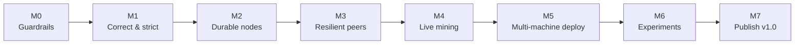

# Roadmap: from one machine to a real network

This file is the single source of truth for where the project stands and what comes next.
Read it at the start of every work session (human or AI). Update the **Status** columns in the same commit as the work.

## Goal

Show, with evidence anyone can reproduce, that the network keeps **one consistent ledger** when nodes run on **separate machines over a real network**, through crashes, network partitions, and a dishonest peer.

**Who it's for:** someone reading the README for two minutes (recruiter, interviewer), and me explaining it in an interview.

**"Next level" is done when all of these are true:**

1. At least 3 nodes run on at least 3 separate machines and agree on one chain.
2. Honest nodes reject every invalid block a dishonest peer sends (forged coinbase, overspend, replay, bad PoW).
3. A node killed with `kill -9` restarts from disk with its chain intact.
4. After a network partition heals, all nodes converge without manual help.
5. The README shows measured results from those machines, produced by one documented command.

Every must-have task below traces back to one of these five outcomes (column **Why**).

## Where we are (verified 2026-10-18)

| Check | Result |
|---|---|
| `pytest tests/ -q` | ✅ 35/35 pass |
| `python simulate_failures.py` (5 runs) | ⚠️ 3 of 5 runs passed all 8 checks. In the other 2, the check "All nodes converge on the same tip" failed: node A ended on a different tip from B and C |
| Docker Compose 3-node network | ✅ (verified 2026-10-12) |

**Known gaps, found in the code:**

- **Fork healing is flaky.** Likely cause (not yet confirmed): catch-up asks for blocks by *index* (`/blocks/since/<n>`), so a node that misses a fork block never fetches the missing parent. Broadcasts run one thread per message, so blocks can arrive out of order.
- **Blocks from peers are under-validated.** `add_block` checks only PoW, signatures, and that the parent is known ([chain.py:37](../blockchain/chain.py)). Any COINBASE transaction is valid ([transaction.py:52](../blockchain/transaction.py)), there is no balance or replay check inside blocks, and the block index isn't checked.
- **Full sync bypasses the block store.** It overwrites `_block_store` directly, without the lock ([synchronizer.py:96](../sync/synchronizer.py)), and drops side branches.
- **`/mine` can report success for a block that isn't on the main chain.** `add_block` returns `True` for side-branch blocks, so the 409 at [node.py:168](../network/node.py) never fires.
- **No persistence.** The chain lives in memory only.
- **One seed node, no peer exchange.** Nodes only learn about peers that register with them, so the simulation calls `cross_register` by hand.
- **Mining is manual.** It only runs on `POST /mine`.
- **Flask dev server, no lint/type checks, no CI.** `pytest` is mixed into runtime `requirements.txt`.

## Scope

| Must-have (this roadmap) | Later (only after v1.0) | Not needed (don't build) |
|---|---|---|
| Correct fork healing | Live web dashboard | Kubernetes, Terraform, Ansible |
| Full block validation | Most-cumulative-work chain choice + difficulty retargeting | Raw TCP / gRPC / libp2p (HTTP is fine) |
| Disk persistence | UTXO model, short hashed addresses | PoS, PBFT, Raft, smart contracts |
| Multiple seeds, peer exchange, periodic sync | TLS / signed peer messages | Database servers, Redis, message brokers |
| Background mining | Fees, mempool limits | Web wallet UI, real money |
| Minimal wallet CLI | Fork-rate vs latency study (`tc netem`) | Rewrite in Go/Rust, microservices |
| Deploy on 3+ machines | Faster tip lookup (`_find_tips` scans every block) | |
| 4 experiments + README results | Property-based tests | |
| | Narrow blind `except Exception` blocks (`signing.py`, `transaction.py`, simulation); stricter ruff rules | |

**Rule:** a new idea goes into **Later** by default. It moves to Must-have only if it's needed for one of the five outcomes.

## Roadmap

Milestones run **in order, one at a time**. Each ends with a **gate**: the next milestone doesn't start until the gate passes.

| Milestone | Goal | Gate (must pass to move on) | Status |
|---|---|---|---|
| **M0 Guardrails** | One command tells us if anything broke | `scripts/check.sh` passes locally and in CI | done |
| **M1 Correct & strict** | Forks always heal; invalid blocks are always rejected | check.sh green; simulation passes 20/20 runs in a row | todo |
| **M2 Durable nodes** | Nodes survive a hard kill | `kill -9` + restart test passes with no peers online | todo |
| **M3 Resilient peers** | No single point of failure; partitions heal by themselves | Simulation passes with `cross_register`/`force_sync` removed, plus a new partition test | todo |
| **M4 Live mining** | The network runs on its own, like a real one | 3 auto-mining nodes stay converged for 10 min locally | todo |
| **M5 Multi-machine deploy** | Same network, separate machines | `scripts/smoke.py` passes against the 3+ remote nodes | todo |
| **M6 Experiments** | Evidence | E1–E4 produce CSVs in `results/` from one command each | todo |
| **M7 Publish v1.0** | Readers see it | README updated, demo added, `v1.0` tagged, VMs torn down | todo |

## Decisions (mine to make)

AI may recommend; I decide. Record the choice and date here before starting the task that depends on it.

| ID | Decision | Options | Recommendation | Needed by | Choice |
|---|---|---|---|---|---|
| D1 | Where to run nodes | (a) 3 cloud VMs in 3 regions · (b) machines on one LAN · (c) mix | (a): real cross-region latency is the point; shut VMs down between sessions | M5 | — |
| D2 | Storage format | JSON-lines file of blocks · SQLite | JSON-lines: no schema, easy to inspect, append-only | M2 | — |
| D3 | Production server | Waitress · Gunicorn (1 worker, threads) | Waitress: runs on Windows too. Node state is in-process, so **never** run multiple workers | M5 | — |
| D4 | How a node fetches missing parents | Walk back by hash (`GET /blocks/<hash>`) · Bitcoin-style block locator | Walk back by hash with a depth limit: simplest thing that fixes the gap | M1 | — |
| D5 | How to time propagation across machines | Nodes log receive times (needs NTP-synced clocks) · one observer polls all nodes | Node event logs; report the clock-sync caveat | M4 | — |
| D6 | Branching | Commit to `main` · branch + PR per milestone | PR per milestone so CI runs on it; push only with my OK | M0 | — |

## How we work

- **Small increments.** Each backlog item is one sitting and one commit. If it's bigger, split it before starting.
- **One thing in progress.** Finish (or explicitly park) an item before starting the next. No drive-by refactors; note them under Later.
- **Test first for bugs.** Reproduce with a failing test, then fix.
- **Definition of done:** acceptance criteria met · new or changed behaviour has a test · `scripts/check.sh` green · docs touched if behaviour changed · Status updated here · committed.
- **Division of work:**

  | AI does | I do |
  |---|---|
  | Implementation, tests, debugging, refactors, research, draft docs | Decisions D1–D6, reviewing each diff, running each milestone gate myself, approving every push, owning cloud accounts and costs |

- **Time-box investigations.** If a root cause isn't found in two sessions, stop and re-plan instead of piling on fixes.
- **Numbers rule:** only report numbers measured by a committed script, and state machine count, regions, difficulty and date beside them.

## Backlog

Status: `todo` · `doing` · `done` · `parked`. **Why** maps to outcomes 1–5 above (G = guardrail for all of them).

### M0 Guardrails

| ID | Task | Why | Done when | Status |
|---|---|---|---|---|
| B-01 | Move `pytest` and dev tools into `requirements-dev.txt` | G | Docker image builds without pytest; dev install works | done |
| B-02 | Add `ruff` (lint + format) via `pyproject.toml`; fix findings | G | `ruff check .` and `ruff format --check .` exit 0 | done |
| B-03 | Add `mypy` (non-strict) for all packages; fix findings | G | `mypy .` exits 0 | done |
| B-04 | `scripts/check.sh`: ruff + mypy + pytest | G | One command, non-zero exit on any failure | done |
| B-05 | GitHub Actions runs `check.sh` on push and PR | G | Green run on a PR; CI badge in README (counts toward the 2-badge max) | done |
| B-06 | `simulate_failures.py --runs N` | G | Prints pass count over N runs and exits non-zero if any run fails | done |

### M1 Correct & strict

| ID | Task | Why | Done when | Status |
|---|---|---|---|---|
| B-10 | Reproduce the fork-convergence flake in a deterministic unit test (deliver child before parent) | 4 | The test fails on current code, and the root cause is written in its docstring | todo |
| B-11 | Fetch missing ancestors by hash (D4) when a block's parent is unknown | 4 | B-10 passes; `simulate_failures.py --runs 20` → 20/20 | todo |
| B-12 | Route full sync through `add_block`; no direct `_block_store` writes outside `Blockchain` | 4 | Grep shows no external writes; side branches survive a full sync (test) | todo |
| B-13 | Reject a block unless `index == parent.index + 1` | 2 | Unit test | todo |
| B-14 | Coinbase rules: exactly one, first in the block, amount = reward | 2 | Unit tests for each violation | todo |
| B-15 | Validate balances inside a block, applied in order on the parent's state | 2 | Overspending block is rejected (test) | todo |
| B-16 | Replay protection: tx_id unique within the block and the branch | 2 | Replayed signed tx rejected (test) | todo |
| B-17 | Mempool subtracts pending spends when admitting a tx | 2 | Two txs that together overspend: second rejected (test) | todo |
| B-18 | `/mine` returns 409 when its block lands on a side branch | 4 | Test with a concurrent competing block | todo |
| B-19 | Minimal `wallet.py`: `keygen`, `send`, `balance`; nodes can mine to a key file (`MINER_KEY_FILE`) | 1, 5 | Integration test: keygen → mine → send → mine → same balance on all nodes | todo |

### M2 Durable nodes

| ID | Task | Why | Done when | Status |
|---|---|---|---|---|
| B-20 | Append every accepted block (incl. side branches) to `DATA_DIR/blocks.jsonl` (D2) | 3 | File grows by one line per new block (test) | todo |
| B-21 | On startup, replay the file through `add_block` (re-validates) | 3 | Kill -9, restart with no peers, chain identical (test) | todo |
| B-22 | Tolerate a truncated last line (crash mid-write) | 3 | Test with a cut-off file | todo |
| B-23 | Docker volume per node in `docker-compose.yml` | 3 | `docker compose restart node2` keeps its chain | todo |

### M3 Resilient peers

| ID | Task | Why | Done when | Status |
|---|---|---|---|---|
| B-30 | `SEED_PEERS=a,b,c`: try each seed on startup | 1 | Node joins with the first seed down (test) | todo |
| B-31 | Peer exchange: register returns the peer list, and the node merges it and registers back | 1 | 3 nodes seeded only from node 1 become fully connected | todo |
| B-32 | Liveness: ping peers periodically, drop one after K failures; never add self | 1, 4 | Dead peer disappears from `/peers`, rejoins when back | todo |
| B-33 | Broadcast through a small thread pool with bounded retries | 4 | Failed send retried; thread count stays bounded under load | todo |
| B-34 | Periodic sync: every N s, compare tips with a random peer and catch up (uses B-11) | 4 | Partition test: two halves mine apart, reconnect, converge without manual sync | todo |
| B-35 | Remove `cross_register`/`force_sync` from the simulation | 1, 4 | `simulate_failures.py --runs 20` → 20/20 without them | todo |

### M4 Live mining

| ID | Task | Why | Done when | Status |
|---|---|---|---|---|
| B-40 | Background miner (`AUTO_MINE=1`) that restarts when the tip changes; keep `/mine` for tests | 1, 4 | 3 local nodes auto-mine for 10 min and stay converged | todo |
| B-41 | Move startup sync out of `create_app` so the server binds first | 1 | Node answers `/status` while a slow seed is still syncing | todo |
| B-42 | JSON-line event log: `block_mined`, `block_accepted` (hash, received_at), `reorg` (D5) | 5 | Events parseable by a script; one line per event | todo |

### M5 Multi-machine deploy

| ID | Task | Why | Done when | Status |
|---|---|---|---|---|
| B-50 | Decide D1 and D3; record here | 1 | Choices filled in above | todo |
| B-51 | Run under the production server (D3), single process | 1 | Same tests pass; no dev-server warning | todo |
| B-52 | `docs/DEPLOY.md`: one `docker run` per machine (`PUBLIC_ADDR`, `SEED_PEERS`, `DATA_DIR`) | 1, 5 | A new machine joins by following the doc alone | todo |
| B-53 | Firewall: node port open only to the other nodes and my IP (HTTP has no auth) | 1 | Port unreachable from outside the allow-list | todo |
| B-54 | `scripts/smoke.py --nodes a,b,c`: all up, mine, converge, one wallet payment end-to-end | 1 | Passes against the remote nodes | todo |
| B-55 | Cost guard: budget alert + "stop VMs" step at the end of each session | — | Alert configured; step in DEPLOY.md | todo |

### M6 Experiments

| ID | Task | Why | Done when | Status |
|---|---|---|---|---|
| B-60 | `experiments/run.py <scenario> --nodes ...` writes CSV to `results/` | 5 | One command per scenario; reruns produce comparable files | todo |
| B-61 | **E1 Propagation:** time for a block to reach every node across regions (p50/p95 over N blocks) | 1, 5 | CSV + summary | todo |
| B-62 | **E2 Crash:** kill -9 a node under load, restart from disk, measure catch-up time | 3, 5 | CSV + summary | todo |
| B-63 | **E3 Partition:** block traffic between groups (iptables) while both sides mine, then heal; measure convergence time and transactions returned to the mempool | 4, 5 | CSV + summary | todo |
| B-64 | **E4 Dishonest peer:** script sends each invalid block type to honest nodes | 2, 5 | 0 accepted; `blocks_rejected` matches what was sent | todo |
| B-65 | `experiments/summarize.py`: results table (Markdown) from the CSVs | 5 | Table regenerates from files alone | todo |

### M7 Publish v1.0

| ID | Task | Why | Done when | Status |
|---|---|---|---|---|
| B-70 | README: multi-machine architecture diagram, Results section (setup, date, numbers), remove "single machine" limitation, refresh Next Steps; keep ≤ ~120 lines (details in `docs/`) | 5 | README reviewed by me | todo |
| B-71 | Demo GIF replaces the placeholder | 5 | `docs/demo.gif` shows the network converging | todo |
| B-72 | Tag `v1.0`; mark this roadmap done | — | Tag pushed (with my OK) | todo |
| B-73 | Tear down VMs | — | Billing shows nothing running | todo |
